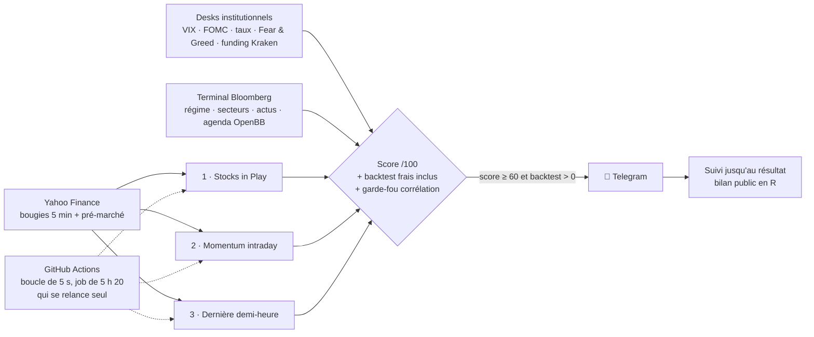

<div align="center">

# 📈 Bot Pro — signaux intraday de niveau institutionnel

**Actions US · Forex · Or · cryptos en perpétuels Kraken 7 j/7 — sur Telegram, 100 % gratuit, 100 % open source**

[](https://github.com/Taxi77777/crypto-signals-timesfm/actions/workflows/tests.yml)
[](https://github.com/Taxi77777/crypto-signals-timesfm/actions/workflows/bot_pro.yml)


*Trois stratégies intraday parmi les mieux documentées par la recherche, une couche « desks
institutionnels » et « terminal Bloomberg », un backtest frais inclus pour chaque signal, et un
**bilan public** : chaque signal est suivi jusqu'à son résultat, gagnant ou perdant.*

**[English summary](#-english-summary)** · **[Stratégies et sources](docs/STRATEGIES.md)** · **[Démarrage en 5 min](#-démarrage-en-5-minutes)**

</div>

---

## ✨ Ce que tu reçois sur Telegram

```text
🪙 CRYPTO
🟢 ACHETER SOL
━━━━━━━━━━━━━━━
💵 Prix d'entrée : 187.910  ·  à faire avant 10:10
🛑 Sortie de sécurité (stop) : 185.400  (perte max 1.34 %)
🎯 Prendre le gain (TP) : 192.930  (gain +2.67 %)
⏰ Fermer de toute façon à 22:55
🔁 Je t'envoie un message quand il faut remonter ta sortie de sécurité
━━━━━━━━━━━━━━━
Fiabilité : ⭐⭐⭐☆☆  (77/100)
📊 Ces 60 derniers jours, la même règle sur SOL : 23 essais, 7 gagnés, au total en GAIN
⚠️ Avantage pas encore prouvé (peu d'historique) : prudence, petite taille
🧭 marché mondial plutôt en baisse
```

Messages en **français simple** par défaut (variable `SIMPLE=0` pour la version détaillée avec score, R, intervalle de confiance).

Le bot dit aussi quand il n'y a pas d'avantage démontré : c'est voulu.

| Message | Quand (heure de Paris*) |
|---|---|
| 🏛 **Briefing marché** : indices mondiaux, VIX, DXY, taux, or, pétrole, BTC, rotation sectorielle, courbe des taux, Fear & Greed, funding crypto, Fed (FOMC), agenda économique, régime risk-on / risk-off | 8 h |
| 🌅 **Pré-ouverture** : plus gros gaps haussiers / baissiers de Wall Street avec volume | 15 h 15 (9 h 15 New York) |
| 🇺🇸 **Stocks in Play** : actions « en jeu » du jour, ordre stop, SL, taille | 15 h 36 (9 h 36 NY) |
| 🔔 **Déclenché** : un ordre Stocks in Play est touché | jusqu'à 21 h 30 (15 h 30 NY) |
| ⚡ **Momentum intraday** : ETF et grandes actions US, 11 paires forex + or / argent, 56 cryptos 7 j/7 | toutes les 30 min |
| ⏱ **Dernière demi-heure** : le meilleur de SPY, QQQ, IWM, DIA | 21 h 30 (15 h 30 NY) |
| ✅🛑 **Résultat** : chaque signal suivi jusqu'à sa sortie (stop, stop suiveur, fin de séance), noté en R frais inclus | dès la sortie |
| 📊 **Résumé du jour** + 📒 bilan (bilan de la semaine le dimanche) | 22 h 02 (23 h 02 l'été) |

\* Les heures de Wall Street sont calculées depuis New York : pendant les semaines où l'Europe et
les États-Unis ne changent pas d'heure le même jour (fin mars, fin octobre), elles arrivent 1 h plus tôt à Paris.

## 🧠 Les stratégies (détails et sources : [docs/STRATEGIES.md](docs/STRATEGIES.md))

| | Stratégie | Source | Résultat publié |
|---|---|---|---|
| 1 | **Stocks in Play** : cassure de la 1re bougie 5 min sur les actions au plus fort volume relatif d'ouverture, stop à 10 % de l'ATR 14 j, sortie en fin de séance | Zarattini, Barbon & Aziz (2024), SSRN 4729284 | Sharpe 2,81, 2016-2023, sur tout le marché US |
| 2 | **Momentum intraday** : sortie de la « zone de bruit » du bon côté de la VWAP, décision toutes les 30 min, stop suiveur max(borne, VWAP), sortie en fin de séance | Zarattini, Aziz & Barbon (2024) « Beat the Market » ; Gao, Han, Li & Zhou (2018) | momentum intraday documenté sur le SPY et 10 autres ETF très échangés |
| 3 | **Dernière demi-heure** : à 15 h 30 New York, dans le sens du mouvement depuis la clôture de la veille, sortie à la clôture | Baltussen, Da, Lammers & Martens (2021) ; Gao et al. (2018) | Sharpe 0,87 à 1,73 selon les classes d'actifs, 1974-2020 |

**Couche desks institutionnels** (sources publiques : Man Group, Fed de New York) : ciblage de volatilité
(risque ÷ 2 si VIX ≥ 25), dérive pré-FOMC, courbe des taux 10 ans − 3 mois, Fear & Greed (CNN, alternative.me),
funding et open interest Kraken Futures, pré-ouverture.

**Couche « terminal Bloomberg »** : régime de marché (S&P vs MM50, VIX), briefing multi-actifs, rotation des
11 secteurs, actualités, résultats d'entreprise et agenda économique (OpenBB / Yahoo).

**Validation et gestion du risque**
- score de confluence sur 100 (détail par stratégie dans la doc) : un signal part seulement si le score atteint
  60 **et** si le backtest de la même règle sur l'actif (60 jours, ≥ 12 trades, **frais inclus**) est gagnant en moyenne ;
- backtest prudent : si la bougie d'entrée touche aussi le stop, c'est une perte ; un gap au-delà du stop s'exécute à l'ouverture ;
- intervalle à 90 % du R moyen et 10 000 rejeux du passé, affichés pour information ;
- **garde-fou de corrélation** : au plus 3 positions ouvertes dans le même sens par classe d'actifs, une seule
  pour la dernière demi-heure (SPY, QQQ, IWM et DIA bougent ensemble) ;
- **taille de position** (devise du compte, devise de cotation forex, exposition plafonnée à 4× le capital) ;
- **bilan public** : `bot_pro_state.json` → `track` (résultats en R uniquement, aucun montant).

## 🏗 Architecture



## 🚀 Démarrage en 5 minutes

1. **Fork** ce dépôt, puis onglet **Actions** → *I understand my workflows, go ahead and enable them*
   (GitHub désactive les workflows planifiés des forks).
2. Crée un bot Telegram avec [@BotFather](https://t.me/BotFather) et récupère ton `chat_id`.
3. **Settings → Secrets and variables → Actions → Secrets** : `TELEGRAM_BOT_TOKEN`, `TELEGRAM_CHAT_ID`
   et, si tu veux la taille de position calculée, `CAPITAL` (en secret : il reste masqué dans les journaux publics).
4. Onglet **Actions** → *Bot Pro* → **Run workflow**. Le bot tourne de 6 h à 21 h 30 UTC, 7 j/7, et se relance seul.

En local : `pip install -r requirements.txt && python bot_pro.py` · tests : `python -m pytest -q`

## ⚙️ Réglages (toutes facultatives)

| Nom | Où | Rôle | Défaut |
|---|---|---|---|
| `CAPITAL` | **secret** | capital pour la taille de position (vide = formule seulement) | — |
| `ACCOUNT_CCY` | variable | devise du capital (`EUR` ou `USD`) | `EUR` |
| `RISK_PCT` | variable | risque par trade en % du capital | `1` |
| `MAX_LEV` | variable | exposition maxi par signal, en multiple du capital | `4` |
| `VOL_CUT` | variable | ciblage de volatilité : risque ÷ 2 au-dessus de ce VIX (actions) | `25` |
| `MIN_SCORE` | variable | score mini pour envoyer | `60` |
| `NEED_BT` | variable | `1` = backtest de l'actif gagnant exigé | `1` |
| `MAX_SAME` | variable | positions max dans le même sens par classe d'actifs | `3` |
| `SIP_STOCKS` | variable | univers Stocks in Play | 177 actions US liquides |
| `SIP_TOP` · `SIP_SEND` | variable | candidats retenus (volume relatif) · ordres envoyés (meilleurs scores) | `20` · `10` |
| `SIP_RVOL` · `SIP_ATR_STOP` | variable | volume relatif mini · stop en fraction d'ATR | `1.0` · `0.10` |
| `MOM_STOCKS` · `MOM_FX` · `MOM_CRYPTO` | variable | univers momentum | 18 ETF / méga-caps · 11 paires + or/argent · 56 cryptos |
| `LH_STOCKS` · `LH_MIN` · `LH_MAX` | variable | dernière demi-heure : ETF · mouvement mini depuis la veille · signaux par sens | `SPY,QQQ,IWM,DIA` · `0.004` · `1` |
| `COST_BPS_STOCKS` · `_FX` · `_CR` | variable | frais + écart aller-retour estimés (points de base) | `3` · `1.5` · `10` |

## ⚠️ Avertissement

Outil **éducatif**. Il n'envoie **aucun ordre** et n'est **pas un conseil financier**. Les études citées
portent sur le passé, avec leurs propres hypothèses ; un backtest sur 60 jours est un petit échantillon et ne
garantit rien. Le trading avec effet de levier peut faire perdre plus que la mise. Projet indépendant, sans lien
avec Bloomberg, BlackRock, JPMorgan ni les auteurs cités. Données Yahoo / CNN / Kraken non officielles, avec retard possible.

## 🌍 English summary

Free, open-source **intraday signal bot** for US stocks, forex, gold and 56 cryptocurrencies, delivered to Telegram
and running for free on GitHub Actions. Three published strategies: **Stocks in Play** opening-range breakout
(Zarattini, Barbon & Aziz, 2024), **intraday momentum** with a noise boundary and VWAP trailing stop
(Zarattini, Aziz & Barbon, 2024; Gao et al., 2018) and **last-half-hour momentum** (Baltussen et al., 2021).
An institutional layer adds volatility targeting, pre-FOMC drift alerts, the yield curve, Fear & Greed and
Kraken perpetual funding; a Bloomberg-style layer adds a cross-asset briefing, market regime, sector rotation,
news and the economic calendar. Each signal needs a score ≥ 60 and a profitable per-asset backtest **after costs**,
and is then **tracked to its outcome** in a public R-multiple track record. Educational only; no orders are sent.

## 🤝 Contribuer

Idées, issues et pull requests bienvenues : voir [CONTRIBUTING.md](CONTRIBUTING.md). Licence [MIT](LICENSE).
