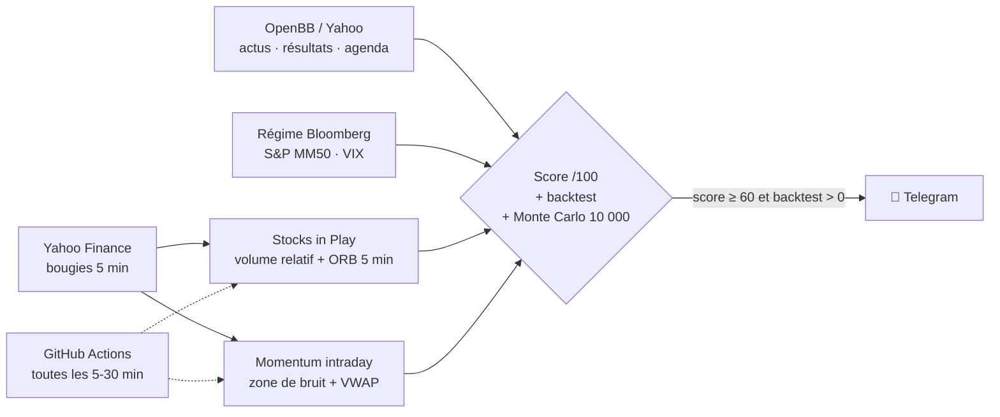

<div align="center">

# 📈 Bot Pro — signaux intraday de niveau institutionnel

**Actions US · Forex · Or · Crypto — sur Telegram, 100 % gratuit, 100 % open source**

[](https://github.com/Taxi77777/crypto-signals-timesfm/actions/workflows/tests.yml)
[](https://github.com/Taxi77777/crypto-signals-timesfm/actions/workflows/bot_pro.yml)


*Deux stratégies intraday parmi les mieux documentées par la recherche, un filtre de régime façon
terminal Bloomberg, et chaque signal validé par un backtest + 10 000 simulations Monte Carlo.*

**[English summary](#-english-summary)** · **[Stratégies](docs/STRATEGIES.md)** · **[Démarrage en 5 min](#-démarrage-en-5-minutes)**

</div>

---

## ✨ Ce que tu reçois sur Telegram

```text
🟢 ACHAT SOL · 🪙 Crypto
⚡ Momentum intraday (zone de bruit + VWAP)
━━━━━━━━━━━━━━━
▶️ Entrée    187.91
🛑 SL        185.40  (-1.34 %)
🎯 TP        192.93  (2R indicatif)
🔁 Stop suiveur : remonter le SL à max(borne, VWAP) toutes les 30 min
⏰ Sortie au plus tard 22:55 · ⌛ valable jusqu'à 10:10 (Paris)
━━━━━━━━━━━━━━━
🟢 SIGNAL FORT · score 87/100 ▰▰▰▰▰▰▰▰▰▱
✅ Sortie de la zone de bruit
✅ Tendance 1 h (EMA 20/50)
✅ Force relative vs BTC
✅ Volume relatif 30 min
✅ Régime de marché
✅ Backtest de l'actif
📜 Backtest de la règle sur l'actif : 23 trades · 26 % gagnants · moy. +0.30 R · PF 1.44
🎲 10 000 simulations des 20 prochains trades : gagnant dans 69 % des cas · médiane +5.3 R
🧭 Régime : RISK-ON (S&P au-dessus de sa MM50, VIX calme)
📰 Dernière actualité de l'actif
```

| Message | Quand (heure de Paris) |
|---|---|
| 🏛 **Briefing marché** façon terminal : indices mondiaux, VIX, DXY, taux 10 ans, or, pétrole, BTC, rotation sectorielle, agenda économique, régime risk-on / risk-off | chaque matin à 8 h |
| 🇺🇸 **Stocks in Play** : les actions « en jeu » du jour, avec ordre stop, SL et TP | 15 h 36, jours de bourse |
| 🔔 **Déclenché** : quand le prix touche un ordre Stocks in Play | jusqu'à 17 h |
| ⚡ **Momentum intraday** : ETF et grandes actions, forex et or, crypto 7 j/7 | toutes les 30 min |
| ✅🛑 **Résultat** : chaque signal est suivi jusqu'à sa sortie (TP, stop, fin de séance) et noté en R | dès la sortie |
| 📊 **Résumé du jour** + 📒 bilan des trades (bilan de la semaine le dimanche) | 22 h 05 |

## 🧠 Les stratégies (sources dans [docs/STRATEGIES.md](docs/STRATEGIES.md))

| | Stratégie | Source | Résultat publié |
|---|---|---|---|
| 1 | **Stocks in Play** : cassure de la 1re bougie 5 min sur les actions au plus fort volume relatif, stop à 10 % de l'ATR 14 j, sortie en fin de séance | Zarattini, Barbon & Aziz (2024), SSRN 4729284 | Sharpe 2,81 avec le filtre de volume contre 0,48 sans (2016-2023, frais inclus, sans glissement) |
| 2 | **Momentum intraday** : sortie de la « zone de bruit » (déplacement moyen à la même heure sur 14 jours) du bon côté de la VWAP, décision toutes les 30 min, stop suiveur, sortie en fin de séance | Zarattini, Aziz & Barbon (2024) « Beat the Market » ; Gao, Han, Li & Zhou (2018) « Market intraday momentum » | momentum intraday documenté sur le SPY et sur 16 ETF internationaux |

**Couche Bloomberg** : régime de marché (S&P vs MM50, VIX), briefing multi-actifs, rotation sectorielle,
actualités, résultats d'entreprise et calendrier économique (OpenBB / Yahoo).

**Validation de chaque signal** :
- un **score de confluence sur 100** (cassure, tendance 1 h, VWAP, force relative, volume relatif, régime, backtest) ;
- un **backtest** de la même règle sur l'actif (60 jours de bougies 5 min) ;
- un **Monte Carlo de 10 000 tirages** des 20 prochains trades.

Un signal part seulement si le score atteint 60 et si le backtest de l'actif est gagnant en moyenne.

## 🏗 Architecture



## 🚀 Démarrage en 5 minutes

1. **Fork** ce dépôt.
2. Crée un bot Telegram avec [@BotFather](https://t.me/BotFather) et récupère ton `chat_id`.
3. Dans **Settings → Secrets and variables → Actions**, ajoute `TELEGRAM_BOT_TOKEN` et `TELEGRAM_CHAT_ID`.
4. Onglet **Actions** → *Bot Pro* → **Run workflow**. C'est tout : le bot se relance tout seul, 6 h – 21 h 15 UTC, 7 j/7.

En local : `pip install -r requirements.txt && python bot_pro.py` · tests : `python -m pytest -q`

## ⚙️ Réglages (variables GitHub, toutes facultatives)

| Variable | Rôle | Défaut |
|---|---|---|
| `SIP_STOCKS` | univers Stocks in Play | ~190 actions US liquides |
| `MOM_STOCKS` · `MOM_FX` · `MOM_CRYPTO` | univers momentum | ETF + méga-caps · 11 paires + or/argent · 18 cryptos |
| `MIN_SCORE` | score mini pour envoyer | `60` |
| `MAX_SAME` | garde-fou de corrélation : max de signaux dans le même sens, par classe et par passage | `3` |
| `CAPITAL` | capital pour afficher la taille de position (vide = formule seulement) | — |
| `RISK_PCT` | risque par trade en % du capital | `1` |

## ⚠️ Avertissement

Outil **éducatif**. Il n'envoie **aucun ordre** et n'est **pas un conseil financier**. Les études citées
portent sur le passé, avec leurs propres hypothèses (frais, glissement, exécution) ; un backtest et une
simulation ne garantissent rien. Le trading avec effet de levier peut faire perdre plus que la mise.
Utilise toujours un stop-loss et ne risque que ce que tu peux perdre.

## 🌍 English summary

Free, open-source **intraday signal bot** for US stocks, forex, gold and crypto, delivered to Telegram and
running for free on GitHub Actions. It implements two of the best-documented intraday strategies from
published research — **Stocks in Play** opening-range breakout (Zarattini, Barbon & Aziz, 2024) and
**intraday momentum** with a noise boundary and VWAP trailing stop (Zarattini, Aziz & Barbon, 2024;
Gao et al., 2018) — plus a **Bloomberg-style layer** (morning cross-asset briefing, risk-on/risk-off regime,
sector rotation, news and economic calendar). Every signal gets a **confluence score /100**, a per-asset
**backtest** and a **10,000-path Monte Carlo**. Educational only; not financial advice; no orders are sent.

## 🤝 Contribuer

Les idées, issues et pull requests sont les bienvenues : voir [CONTRIBUTING.md](CONTRIBUTING.md).
Licence [MIT](LICENSE).
